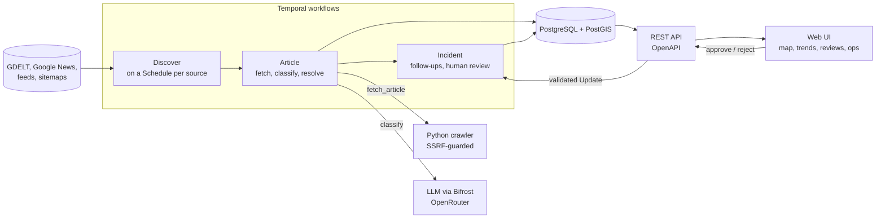
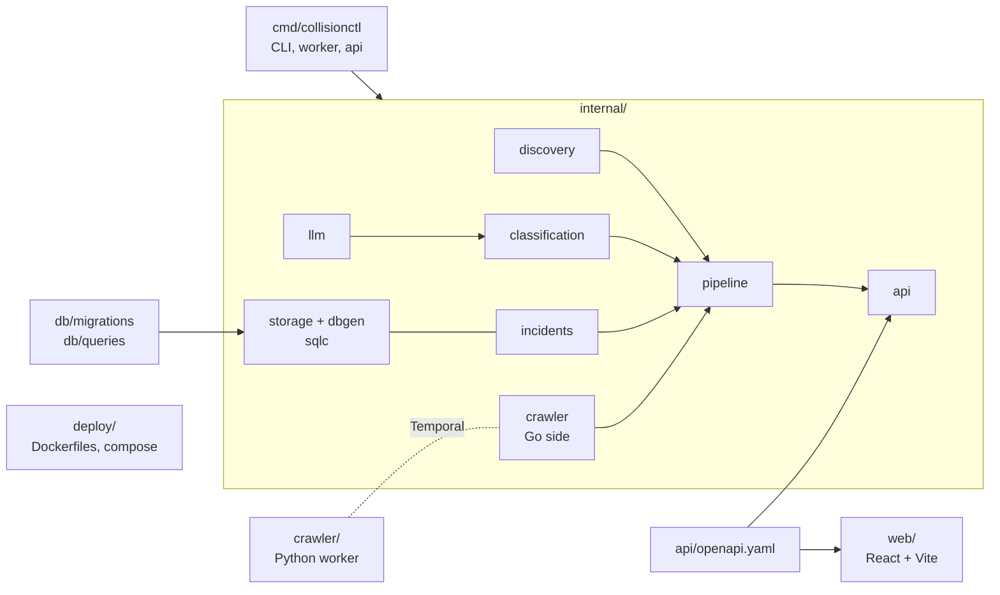

# Vulnerable Road User Collision Intelligence Platform

Finds news reports of motor-vehicle collisions involving vulnerable road users (pedestrians, cyclists, scooter and
wheelchair users, motorcyclists), extracts structured facts with an LLM, merges reports of the same collision into
one incident, and shows the result on a map with trends and a review queue.

Go owns the services, Python only crawls, a React app is the UI, and Temporal orchestrates everything in between.
Design: [`docs/design.md`](docs/design.md). Decisions: [`docs/decisions/`](docs/decisions). Plan and progress:
[`docs/implementation-plan.md`](docs/implementation-plan.md).



## Status
Built and tested: discovery providers, the Python crawler worker, LLM classification with an evaluation harness,
PostGIS persistence with entity resolution, the Temporal workflows (discovery, article, incident, backfill,
reprocess), the REST API, the web UI, a Helm chart with a Grafana dashboard and alerts, and runbooks
(`docs/runbooks/`). Not yet run on the cluster: the infra changes are an unmerged branch and the images are not built.
See "Not built yet" in the design for the full list.

## Quick start (no Kubernetes)
```bash
make test                           # Go + Python tests (no network)
# The Python crawler is a Temporal worker, so fetching needs a Temporal server and both workers:
temporal server start-dev --namespace default &
(cd crawler && CRAWLER_TEMPORAL_ADDRESS=localhost:7233 CRAWLER_TEMPORAL_NAMESPACE=default uv run collision-crawler) &
# Optional, for JavaScript-built pages: uv sync --extra browser && uv run playwright install chromium, then run a second
# worker with CRAWLER_MODE=render and start the others with COLLISION_CRAWLER_RENDER_FALLBACK=true.
export COLLISION_TEMPORAL_ADDRESS=localhost:7233 COLLISION_TEMPORAL_NAMESPACE=default
export COLLISION_DATABASE_URL=postgres://... COLLISION_LLM_MODEL=... COLLISION_LLM_BASE_URL=...
go run ./cmd/collisionctl migrate
go run ./cmd/collisionctl worker &                      # hosts the workflows and Go activities
go run ./cmd/collisionctl schedules sync                # deploy step; afterwards the admin UI keeps schedules in line
COLLISION_SOURCES_SEED_FILE=docs/examples/sources.yaml go run ./cmd/collisionctl api &   # REST API on :8080; seeds an empty database
```
Backfills, reprocessing, schedule control and incident corrections (splitting a wrongly merged article) are in the `/admin` UI, not the CLI. The CLI is for running the services (`api`, `worker`, `migrate`, `schedules sync` at deploy), and debugging one step (`fetch`, `classify`, `eval`).

## API
`collisionctl api` serves the REST API described in `api/openapi.yaml` (regenerate server code with
`make generate`). Incident and statistics reads are open (the service is tailnet-only). Review decisions and every
`/admin` route, source configuration and health reads included, need
`Authorization: Bearer $COLLISION_API_ADMIN_TOKEN` and are disabled when no token is set.

## Sources
Discovery sources and search queries are configured in the database, in the `/admin` UI (type, URL, interval, coverage,
crawl limits, a Test button that runs a configuration once without saving it, per-source health and run history).
Nothing is compiled in. When the API starts and the database has no sources, it loads the seed file named by
`COLLISION_SOURCES_SEED_FILE` (`--seed-file`); it checks on every start and never touches a database that already has
sources. The container image carries `docs/examples/sources.yaml` as a starter list, and the Helm chart can replace it
(`sources.seed`) or turn seeding off (`sources.seedFile: ""`). A new source type is one provider package that describes
its own fields (`Provider.Describe`); see `docs/decisions/0005-sources-are-configuration.md`.

## Search
The map page has a search box (street, city, "fatal cyclist", a headline). It needs an OpenSearch cluster:
`COLLISION_SEARCH_URL` (plus `COLLISION_SEARCH_USERNAME`, `COLLISION_SEARCH_PASSWORD`, and
`COLLISION_SEARCH_INSECURE_SKIP_VERIFY` for a self-signed certificate). Without it the API answers `?q=` with 503 and no indexer
runs. PostgreSQL stays the source of truth; the index is derived from it every minute and can be rebuilt from Admin, Overview.
See `docs/decisions/0006-search-in-opensearch.md`.

## Web UI
`web/` is a React + Vite + TypeScript app (map, trends, incident detail, review queue, and an admin area for sources and queries). Types come from
`api/openapi.yaml`. `cd web && npm run dev` serves on :5173 and proxies `/v1` to `collisionctl api` on :8080. The
container is nginx serving the build, proxying `/v1` to `$API_UPSTREAM`, and writing `config.json` (Temporal UI
link) from `TEMPORAL_UI_URL` at start. The map loads tiles from OpenFreeMap in the browser.

## Layout

`docs/` design, decisions and plan; `tests/evaluations/` holds 15 author-written labelled cases (their harness was removed; it is in git history).

## Tests
```bash
make test               # Go + Python unit tests, no network or Docker needed
make test-integration   # PostGIS integration tests (needs Docker; uses the CNPG PostGIS image)
```
Configuration is viper-based: flags > `COLLISION_*` env vars > `collisionctl.yaml` > defaults
(e.g. `COLLISION_LLM_MODEL`, `COLLISION_LLM_BASE_URL`, `COLLISION_DATABASE_URL`, `COLLISION_TEMPORAL_ADDRESS`).
