# Design

A platform that finds news reports of motor-vehicle collisions involving vulnerable road users, extracts
structured facts with an LLM, merges reports of the same collision into one incident, and shows the result on a map
with trends and a review queue.

Decisions and their reasons are in `docs/decisions/`. The delivery plan is `docs/implementation-plan.md`.

## Principles

- **Evidence first.** Every incident is derived from per-article observations that are kept verbatim. Unknown is
  stored as unknown (NULL), never guessed. Coordinates exist only when a geocoder returned them.
- **Orchestration is Temporal's job.** Retries, timeouts, scheduling, fan-out, human-in-the-loop and long timers are
  workflows. No second RPC layer sits between Go and Python.
- **State lives in PostgreSQL.** Workflow history carries IDs and small summaries only.
- **Cheap to retry, expensive to repeat.** A stored extraction is reused for the same model, prompt and schema, so
  retries and replays never pay for the model twice.
- **Untrusted input.** Web content is fetched behind an SSRF guard, and model output is validated before it is used.
- **Use libraries.** Official SDKs and mainstream libraries over hand-written equivalents.

## System

Four containers of our own, plus services that already run in the cluster. Access is tailnet-only.

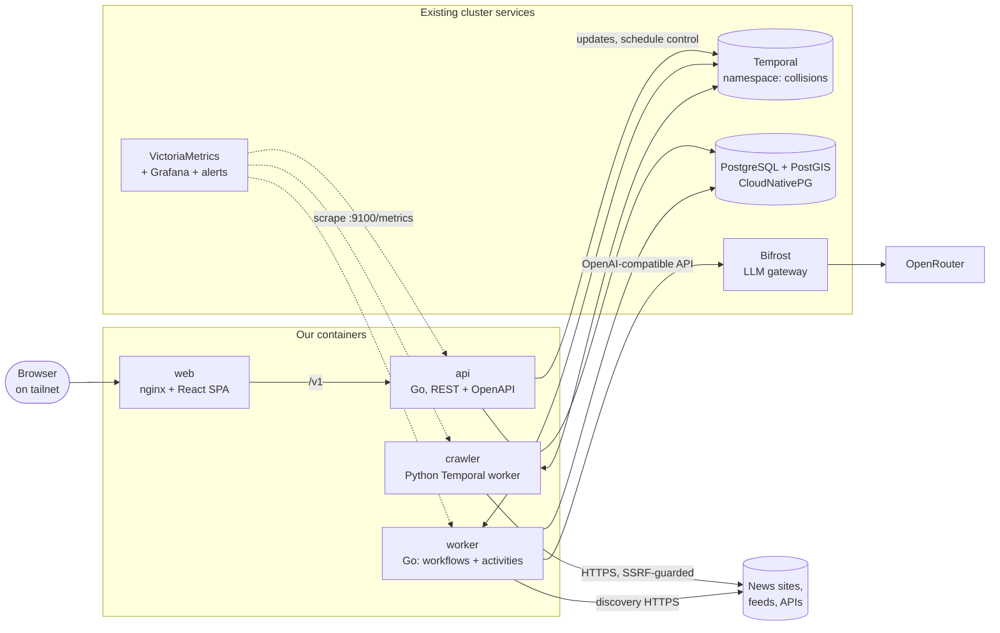

Go and Python never call each other directly. The Python worker serves two activities (`fetch_article`,
`discover_links`) on its own task queue, and Go workflows call them by name. Large payloads (article text) are
compressed by a zlib payload codec implemented on both sides.

## Task queues

Each queue has its own worker, concurrency limit and rate limit, so a slow LLM or a polite crawler cannot starve
database work.

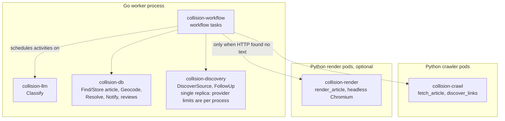

## Discovery

Discovery sits behind one interface with an implementation per source type. A provider describes the source types it
serves and finds candidate URLs; persistence, normalization, deduplication and run history are shared. Which sources
exist is data, not code: see [Managing sources](#managing-sources).

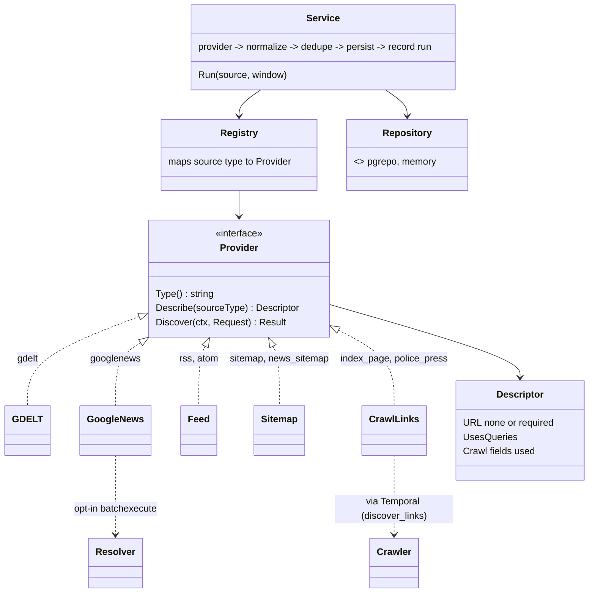

- **GDELT** and **Google News** are search providers driven by configured queries. GDELT allows one request per 5
  seconds, which is enforced with a limiter and limiter-aware retries. Google News links are opaque, so resolving them
  to publisher URLs is an opt-in step that relies on an undocumented endpoint.
- **Feed**, **Sitemap** and **CrawlLinks** read a specific source's URL.
- Every sighting is recorded (`article_discoveries`), so source quality can be measured: duplicates, exclusive finds,
  delay, fetch success and relevance.

### Search

Incident search is an OpenSearch index derived from PostgreSQL ([ADR 0006](decisions/0006-search-in-opensearch.md)).

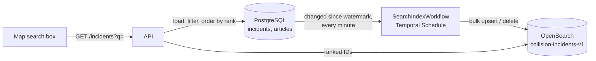

- **What is indexed:** one document per live incident: street, city, county, state, the categories and outcome in plain words
  ("fatal bicyclist hit and run"), circumstances, and the titles, publishers and descriptions of its articles. No article
  text, so nothing outlives the 90-day text retention.
- **How it stays current:** every change to an incident bumps `updated_at`, so the indexer needs no hook in the code that
  changes incidents. It reads after a stored `(updated_at, id)` watermark, writes in bulk, then advances the watermark. A crash
  repeats a batch, which is harmless because writes are by ID. Merged and withdrawn incidents are deleted from the index.
  Rows younger than ten seconds wait, so a transaction that set `updated_at` but has not committed cannot be skipped.
- **How a search runs:** the query is a `simple_query_string` (all words, prefix and phrase allowed, never a syntax error)
  together with a fuzzy `multi_match` (typos, a missing word). The top 500 IDs come back best first; PostgreSQL then applies
  the date, place, category and bounding-box filters to exactly those IDs and returns them in rank order.
- **Operations:** Admin, Overview shows documents, pending changes and the last write, and "Rebuild index" forgets the
  watermark and runs the indexer now. Without `COLLISION_SEARCH_URL` none of this exists. See
  [`docs/runbooks/search.md`](runbooks/search.md).

### Managing sources

Sources (`discovery_sources`) and search queries (`discovery_queries`) are rows in the database, managed in the `/admin`
UI. Nothing is compiled in. On every start the API checks whether the database has any source, and only if it has none
loads the configured seed file (`COLLISION_SOURCES_SEED_FILE`, a YAML list of sources and queries; the image carries
`docs/examples/sources.yaml` as the default and the chart can replace it with `sources.seed`). The check, the writes and an
advisory lock share one transaction, so API replicas starting together seed once. Once any source exists the file is
never read again, so edits and deletions in the admin UI stick. The one consequence: deleting every source and then
restarting the API loads the seed list again. An invalid or missing seed file stops the API from starting, so a bad rollout
keeps the old pods serving instead of coming up empty.

### Bulk jobs and corrections

Backfills, reprocess runs and incident splits are admin actions too, not CLI commands. The CLI keeps only what has to run
without the API: the services, `migrate`, the deploy-time `schedules sync`, and nothing else: there are no debugging or evaluation commands.
There is no source import or export command; the seed file covers a new install and the admin UI covers the rest.

- **Jobs are the workflows themselves.** `POST /admin/backfills` and `/admin/reprocesses` start `BackfillWorkflow` and
  `ReprocessWorkflow`; `GET /admin/jobs` lists them from Temporal's visibility store (nothing is copied into PostgreSQL)
  and asks each for its progress through its query handler, which also answers for finished runs. Pause and resume are
  signals, only for backfills; cancel is a signal for a backfill and a Temporal cancel for a reprocess run. The logic is in
  `internal/pipeline/jobs.go`, where it is tested against a real Temporal server.
- **Bounded by construction.** A backfill needs sources that exist, a range under ten years, and an article limit
  (default 1000); a reprocess run has a limit (default 100, 0 means all and the UI asks first).
- **Splitting an article** (`POST /admin/incidents/{id}/split`) runs the same resolver code as before, under the same
  per-state advisory lock, and records the name given in both incidents' histories. The shared admin token does not say who
  is acting, so the name is typed in and is an audit label, not an identity.

- **The provider is the contract for what a source needs.** `Descriptor` says whether a type takes a URL, runs
  queries, and which crawl limits it reads. Validation (`ValidateSource`, `ValidateQuery`) and the admin form are driven
  by descriptors, so a new source type is one provider package plus one registry line, with no migration (the database
  does not enumerate types) and no UI change.
- **Every run is recorded** in `discovery_runs`: window, status (`success`, `partial`, `failed`), counts found, unique,
  new, known and pending, upstream requests, warnings and the error. Recording and the source's health fields change in
  one transaction. A partial run (the provider failed part way but returned usable candidates) counts as working and keeps
  its error on the run. History is trimmed after 90 days by the retention workflow.
- **Health** is derived, not stored: `disabled`, `paused` (its schedule is paused), `waiting` (no run yet), `failing`
  (three or more runs in a row failed), `stale` (no success for three poll intervals and at least an hour), `degraded`
  (the latest run failed) or `healthy`. Alongside it the admin shows run statistics (success rate, average and p95 time,
  new URLs, requests) and the quality metrics above.
- **Saving a source changes its Temporal Schedule.** Create and update apply the interval and action; the pause state
  follows `enabled` only when that flag changed, so an operator's pause survives an unrelated edit. If Temporal is
  unreachable the save still succeeds and says the schedule was not updated; `Sync schedules` (or the next deploy)
  fixes it, and also removes the schedules of deleted sources. Delete removes the schedule first, so a failure never
  leaves a schedule running for a source that no longer exists.
- **Test** runs a configuration once, unsaved, through a `SourceTestWorkflow` on the discovery worker (the API makes no
  outbound requests). It records nothing, uses at most two queries for search sources, and fails fast with a clear error
  when no discovery worker is polling.

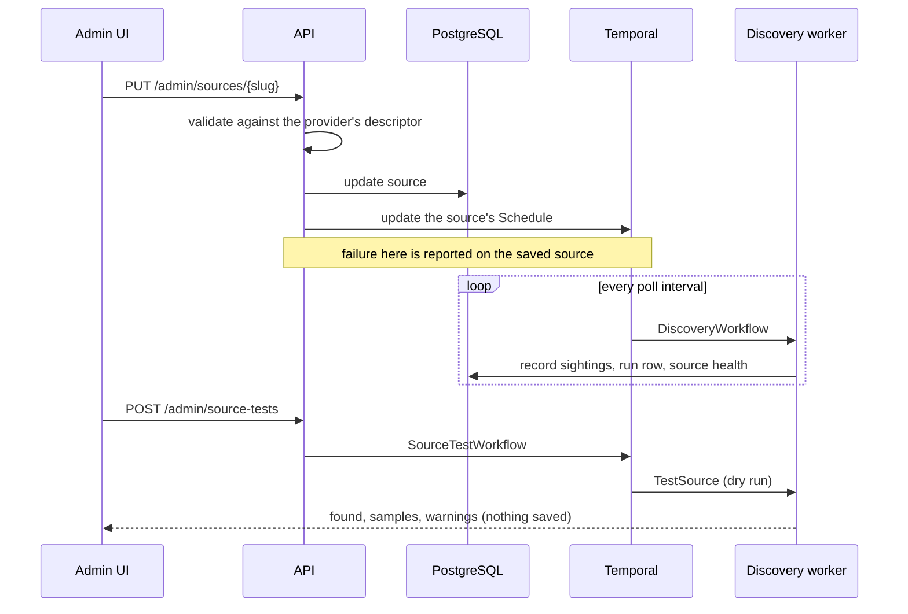

See [ADR 0005](decisions/0005-sources-are-configuration.md).

## Durable pipeline

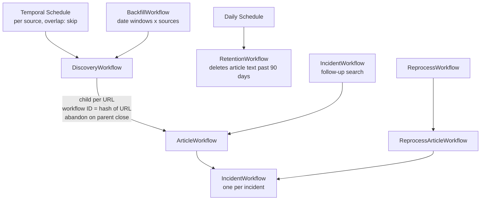

### One article

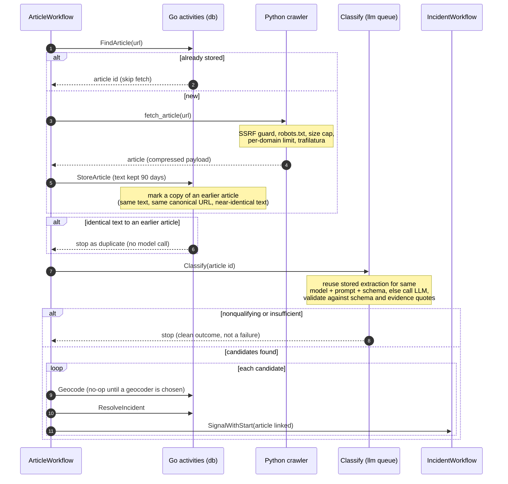

### Duplicate articles

URL normalization catches the same link with different tracking parameters. It cannot catch the same story at a different
address, so `StoreArticle` also compares each fetched article with those already stored (`internal/dedupe`):

| Kind (`duplicate_kind`) | Matches when | Classified? |
|---|---|---|
| `content_hash` | the text is byte-identical | no, the original's extraction stands |
| `canonical_url` | the normalized canonical (else final) URL is the same: AMP pages, redirects, mirrors | yes |
| `near_duplicate` | the 64-bit SimHash of 3-word shingles is within 3 bits, among articles from the last 14 days, text of at least 80 words | yes |

A copy keeps its own row, so its URL is never fetched again, and points at the original in `duplicate_of` (always the
original, never another copy). Copies other than exact ones are still classified because a republished story may carry newer
facts. Corroboration counts **independent sources**: `incidents.article_count` is the number of distinct originals, so three
outlets running one wire story leave an incident `unverified`. The incident page lists every article and marks the copies.

Limits: this finds copies, not independent reports of one event (that is entity resolution, below). The thresholds are set
from synthetic edits, not measured on real news, so they need checking against reviewed examples (see the backlog). Two copies
stored at the same moment can both become originals. Articles stored before fingerprints existed are fingerprinted by
the daily retention run (up to 5000 per run), which does not mark them as duplicates of one another.

Retry policy differs by step: crawl and DB steps retry with backoff; classification retries transient gateway errors
but treats "invalid output" as a terminal outcome recorded on the workflow, not a failure.

### Classification

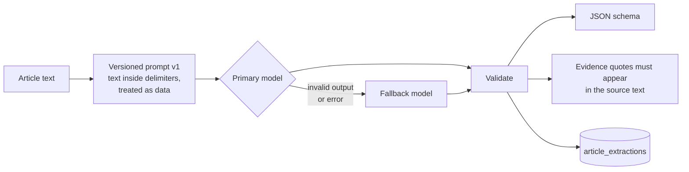

The gateway client probes structured-output support and downgrades `json_schema` to `json_object` to prompt-only.
LLM spend is tracked outside this application.

## Entity resolution

Resolution runs in PostgreSQL inside one transaction, under an advisory lock per state, so parallel workers cannot
create duplicates of the same collision. It is idempotent per (extraction, candidate).

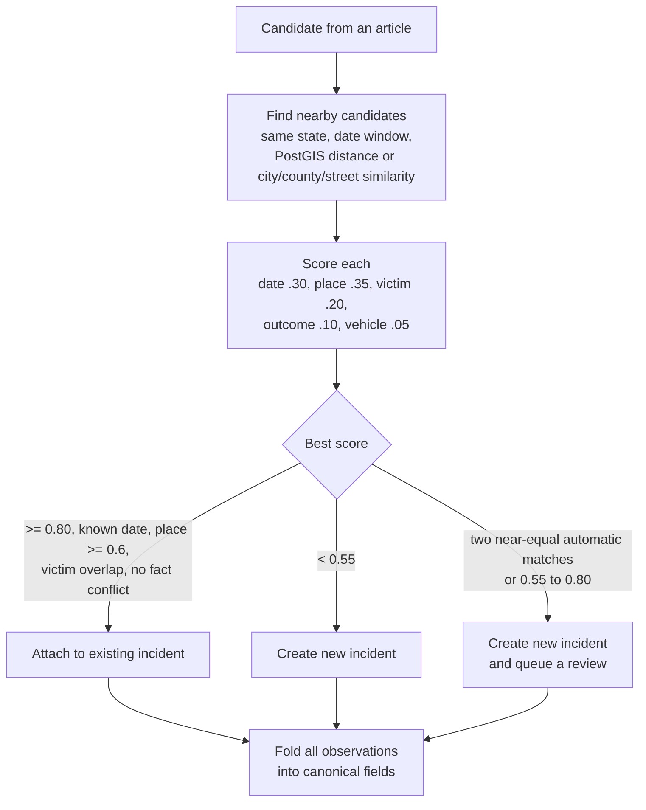

Folding rules: counts only go up and a later, lower count is logged as a conflict; a fact conflict (for example
hit-and-run yes versus no) forces review instead of an automatic match.

## Incident lifecycle

Each incident has a long-lived workflow. Resolution correctness comes from the database lock; the workflow adds
durable timers, human decisions, a status query and visibility.

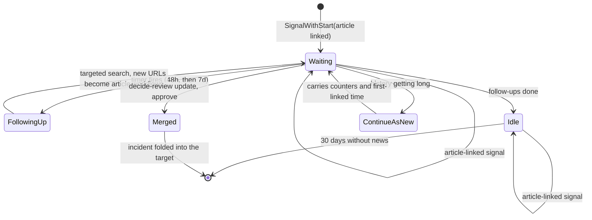

### Human review

A possible duplicate waits in the review queue. The decision is a validated Temporal Update delivered with
update-with-start, so it works even if the incident's workflow is not running.

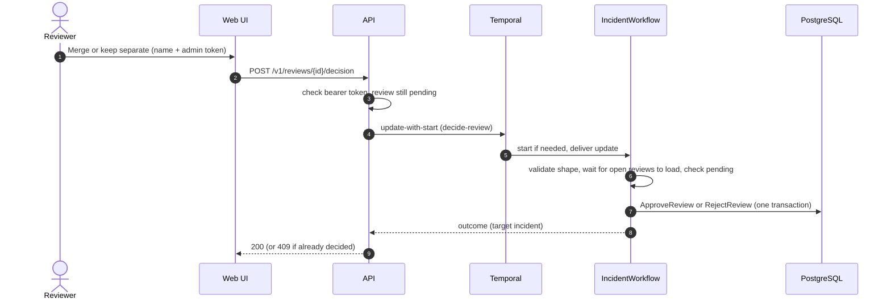

### Backfill and reprocess

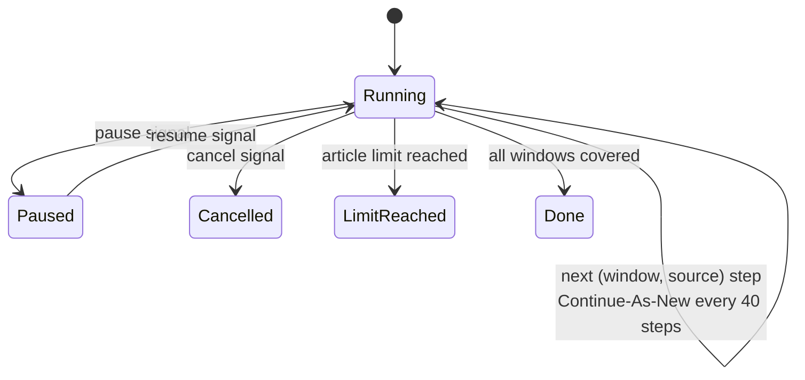

A backfill walks date windows across sources, answers a progress query, and bounds volume with a maximum number of
article workflows. Reprocess pages through retained articles that lack an extraction for the current model, prompt
and schema, compares old and new results, withdraws what the old extraction contributed, and resolves the new one.

## Data model

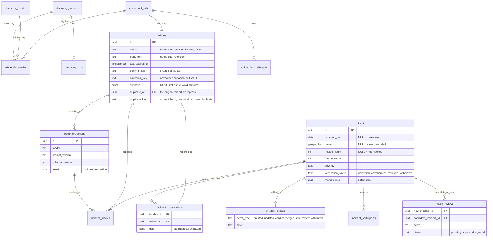

An incident's canonical fields are always recomputed from its observations, so merge, split and reprocessing are
safe operations. Reprocessing can remove all support for an incident, which is then withdrawn (hidden, kept for
audit) rather than deleted.

## Deployment and operations

The Helm chart in `deploy/helm/collision-tracker` is synced by Argo CD from the infra repository, which holds only the
Application and its values. Hooks make a release self-contained: it creates what it needs and refuses to roll out if a
prerequisite fails, leaving the running version in place.

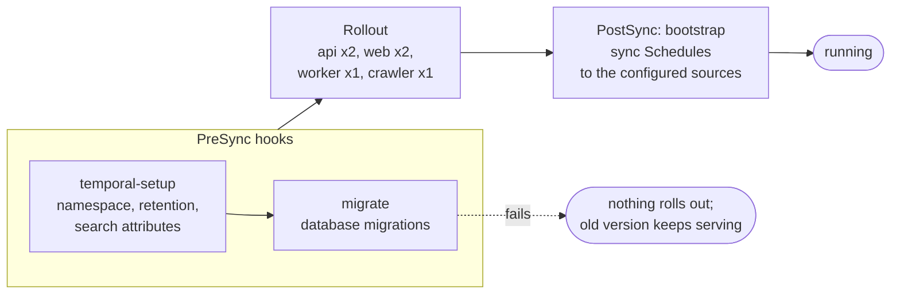

- **Not a superuser.** The database role owns its database only. The operator creates the extensions (PostGIS is not a
  trusted extension), and the first migration's `CREATE EXTENSION IF NOT EXISTS` then does nothing. This was verified as a
  non-superuser both ways.
- **Operator changes survive deploys.** Sources live in the database and bootstrap never writes them. It only makes each
  source's Schedule match (interval and action), keeping a pause an operator set, and removes schedules whose source was
  deleted.
- **Network.** Egress-only policies per component. The worker and crawler may reach public HTTP(S) but not private ranges,
  as a second layer behind the crawler's own SSRF guard.
- **Metrics.** Each process serves `/metrics` on a separate port. Temporal SDK metrics (Go through tally, Python natively)
  use the same names. The API also exports pipeline state read from PostgreSQL at scrape time (articles by status, pending
  reviews, per-source failures and last success), which stays correct across restarts and retries.
- **Alerts and dashboard.** A `VMRule` covers stalled pipelines, failing or stale sources, queue backlog, the review
  queue and API errors; a Grafana dashboard ships as a labelled ConfigMap. Each alert points to a runbook in
  `docs/runbooks/`.

## API and web

The REST API is defined first in `api/openapi.yaml`. Server code and the web client's types are generated from it,
and requests are validated against it, including the bearer scheme on the few POST routes. Reads are open on the
tailnet; admin routes need a token and are disabled when none is configured.

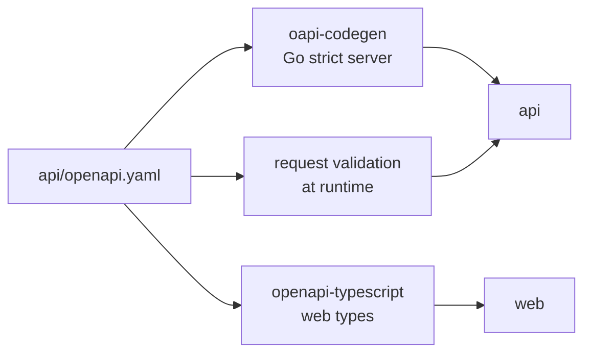

| Page | Data | Temporal feature shown |
|---|---|---|
| Map | clustered incidents with filters kept in the URL | none |
| Trends | summary, time series, breakdowns | none |
| Incident detail | sources (copies marked), per-article observations, audit trail; admins can split an article off | link to the incident's workflow |
| Review queue | side-by-side pairs with differences highlighted | decision as a validated Update |
| Admin (token) | pipeline counters; per-source health, run history, quality; queries; backfill and reprocess runs | schedule pause, resume, run now, sync; test run through a workflow; backfill signals and queries; listing runs from visibility |

## Security

- **Crawler:** every resolved IP is validated and the connection is pinned to the checked IP (defeats DNS
  rebinding); redirects are re-validated per hop; robots.txt, size caps and per-domain limits apply; page content is
  never logged.
- **LLM:** article text is data, wrapped in delimiters and escaped. Output is schema-validated and each evidence
  quote must be found in the source text; "verified" is set by our code, never the model.
- **Privacy:** no names or ages are stored for people involved in a collision.
- **Admin:** shared bearer token compared in constant time, kept in `sessionStorage` in the browser. Every `/admin` API
  route needs it, reads included, because source configuration and health are not public (pipeline counters and the
  incident read API are). Reviewer identity is a typed name recorded in the audit trail, not an authenticated identity.
- **Network:** tailnet-only exposure; in-cluster egress is default-deny with explicit allows (infra repo).

## Rendering JavaScript-built pages

Plain HTTP plus `trafilatura` extracts text from server-rendered pages. Pages that build their article in the browser
come back with no text (`NO_CONTENT`). When `render.enabled` is set, the article workflow escalates exactly those pages:

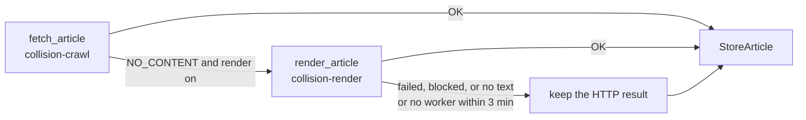

The render pool is a separate Deployment (its own image with Chromium, about 1.5 GB) on its own task queue, so its
memory, concurrency and failures never touch ordinary fetching. Inside a pod one Chromium process is shared; every render
gets a fresh context, and `browser_concurrency` bounds the pages open at once. Every request the page makes, including each
redirect hop, is validated against the same URL policy as the HTTP path and issued by the worker with redirects off,
because Chromium follows redirects without asking the guard again. Non-GET requests, images, media and fonts are refused.
The browser resolves DNS itself, so the pod's egress NetworkPolicy (private ranges denied) is the backstop.
See [ADR 0004](decisions/0004-rendering-on-its-own-queue.md).

## Not built yet

Unscheduled ideas, with reasons and first steps, are in [backlog.md](backlog.md).

- A geocoder (incidents currently match on street, city and county text), a Temporal codec server, and saga-style
  compensation for merge and split (they are single database transactions today).
