# Design

A platform that finds news reports of motor-vehicle collisions involving vulnerable road users, extracts
structured facts with an LLM, merges reports of the same collision into one incident, and shows the result on a map
with trends and a review queue.

Decisions and their reasons are in `docs/decisions/`. The delivery plan is `docs/implementation-plan.md`.

## Principles

- **Evidence first.** Every incident is derived from per-article observations that are kept verbatim. Unknown is
  stored as unknown (NULL), never guessed. Coordinates exist only when a geocoder returned them.
- **Orchestration is Temporal's job.** Retries, timeouts, scheduling, fan-out, human-in-the-loop and long timers are
  workflows. No second RPC layer sits between Go and Python.
- **State lives in PostgreSQL.** Workflow history carries IDs and small summaries only.
- **Cheap to retry, expensive to repeat.** A stored extraction is reused for the same model, prompt and schema, so
  retries and replays never pay for the model twice.
- **Untrusted input.** Web content is fetched behind an SSRF guard, and model output is validated before it is used.
- **Use libraries.** Official SDKs and mainstream libraries over hand-written equivalents.

## System

Four containers of our own, plus services that already run in the cluster. Access is tailnet-only.

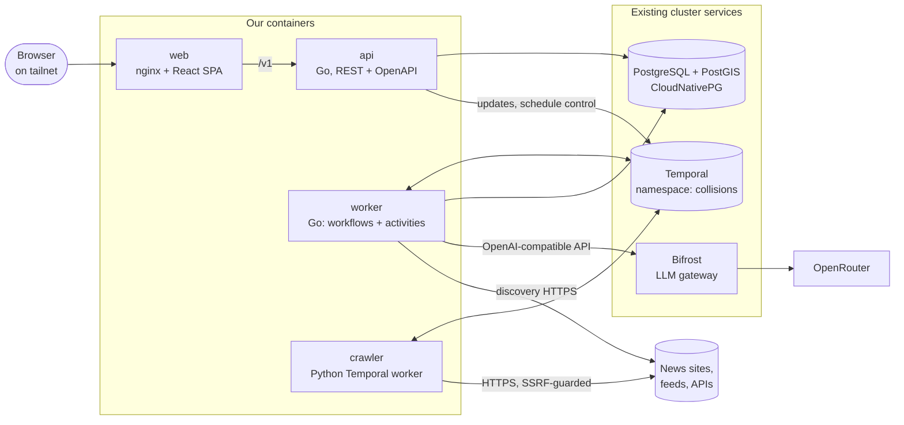

Go and Python never call each other directly. The Python worker serves two activities (`fetch_article`,
`discover_links`) on its own task queue, and Go workflows call them by name. Large payloads (article text) are
compressed by a zlib payload codec implemented on both sides.

## Task queues

Each queue has its own worker, concurrency limit and rate limit, so a slow LLM or a polite crawler cannot starve
database work.

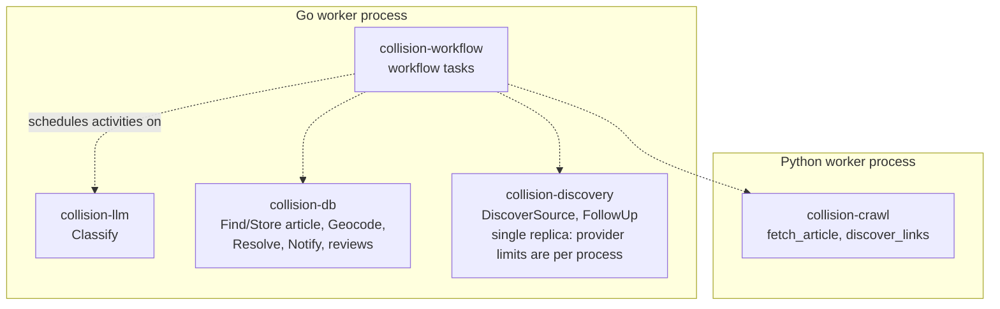

## Discovery

Discovery sits behind one interface with an implementation per source type. A provider only finds candidate URLs;
persistence, normalization and deduplication are shared.

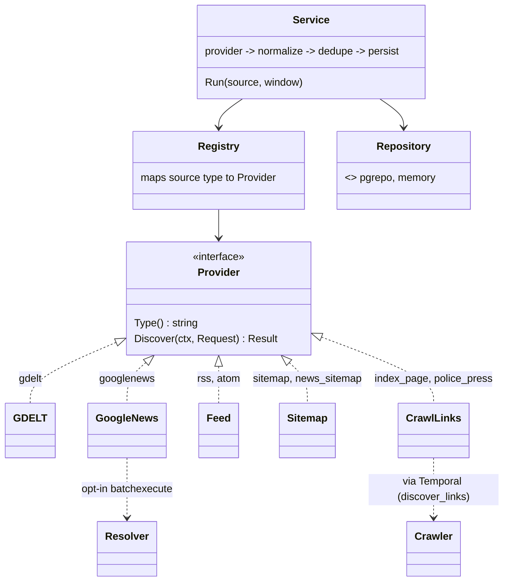

- **GDELT** and **Google News** are search providers driven by configured queries. GDELT allows one request per 5
  seconds, which is enforced with a limiter and limiter-aware retries. Google News links are opaque, so resolving them
  to publisher URLs is an opt-in step that relies on an undocumented endpoint.
- **Feed**, **Sitemap** and **CrawlLinks** read a specific source's URL.
- Every sighting is recorded (`article_discoveries`), so source quality can be measured: duplicates, exclusive finds,
  delay, fetch success and relevance.

## Durable pipeline

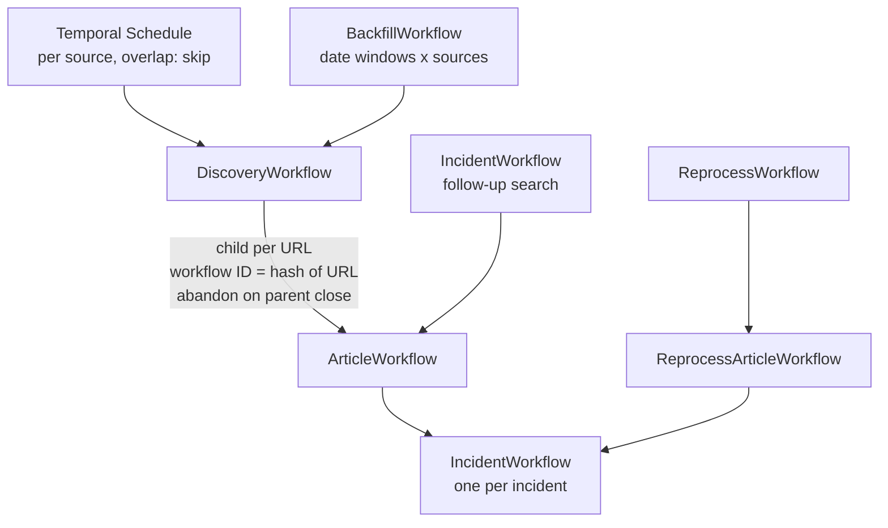

### One article

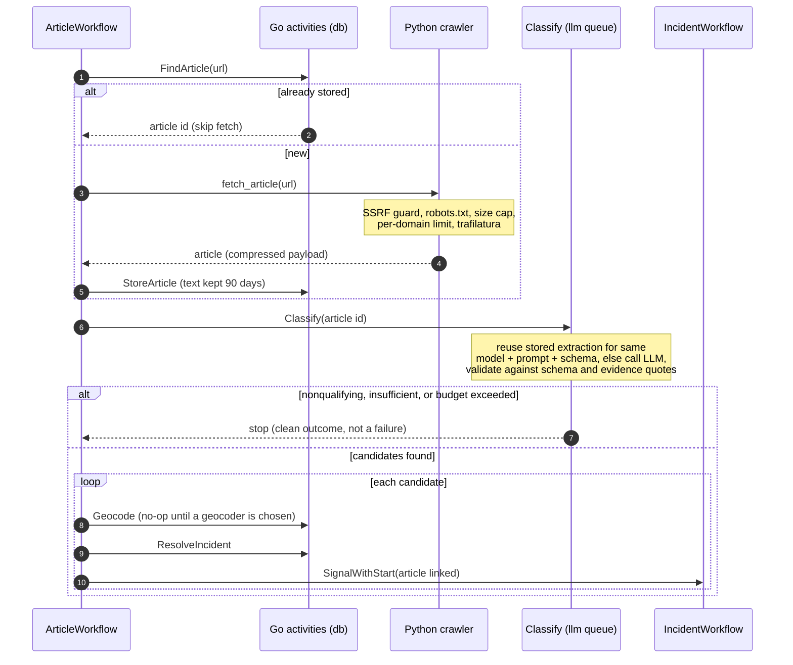

Retry policy differs by step: crawl and DB steps retry with backoff; classification retries transient gateway errors
but treats "budget exceeded" and "invalid output" as terminal outcomes recorded on the workflow, not failures.

### Classification

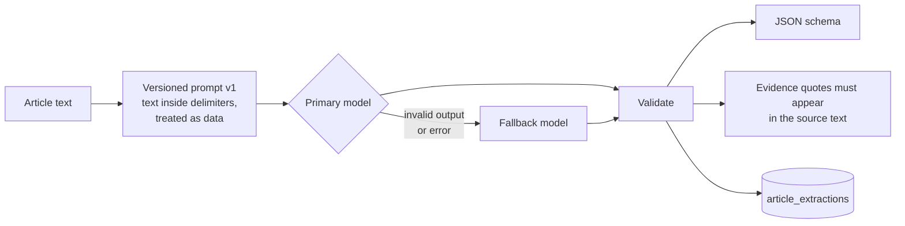

The gateway client probes structured-output support and downgrades `json_schema` to `json_object` to prompt-only.
Token use and cost are tracked per call, with an optional spend limit.

## Entity resolution

Resolution runs in PostgreSQL inside one transaction, under an advisory lock per state, so parallel workers cannot
create duplicates of the same collision. It is idempotent per (extraction, candidate).

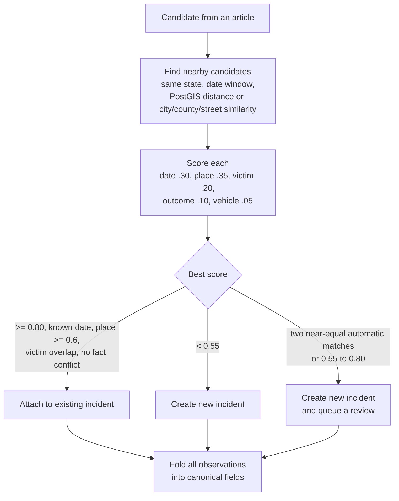

Folding rules: counts only go up and a later, lower count is logged as a conflict; a fact conflict (for example
hit-and-run yes versus no) forces review instead of an automatic match.

## Incident lifecycle

Each incident has a long-lived workflow. Resolution correctness comes from the database lock; the workflow adds
durable timers, human decisions, a status query and visibility.

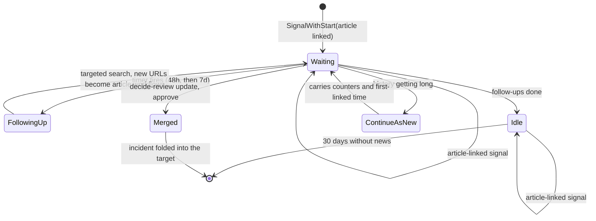

### Human review

A possible duplicate waits in the review queue. The decision is a validated Temporal Update delivered with
update-with-start, so it works even if the incident's workflow is not running.

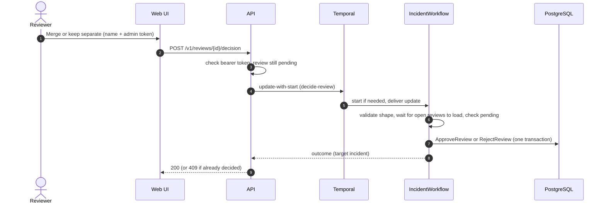

### Backfill and reprocess

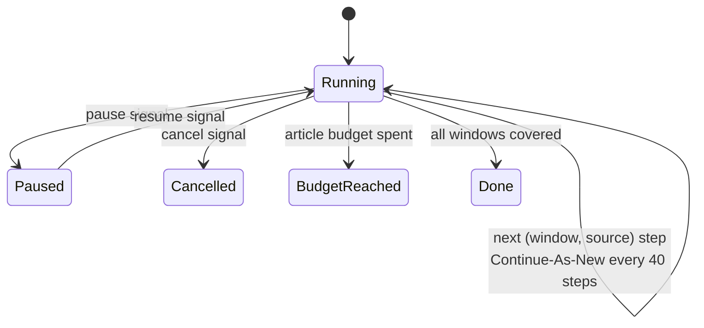

A backfill walks date windows across sources, answers a progress query, and bounds cost with a maximum number of
article workflows. Reprocess pages through retained articles that lack an extraction for the current model, prompt
and schema, compares old and new results, withdraws what the old extraction contributed, and resolves the new one.

## Data model

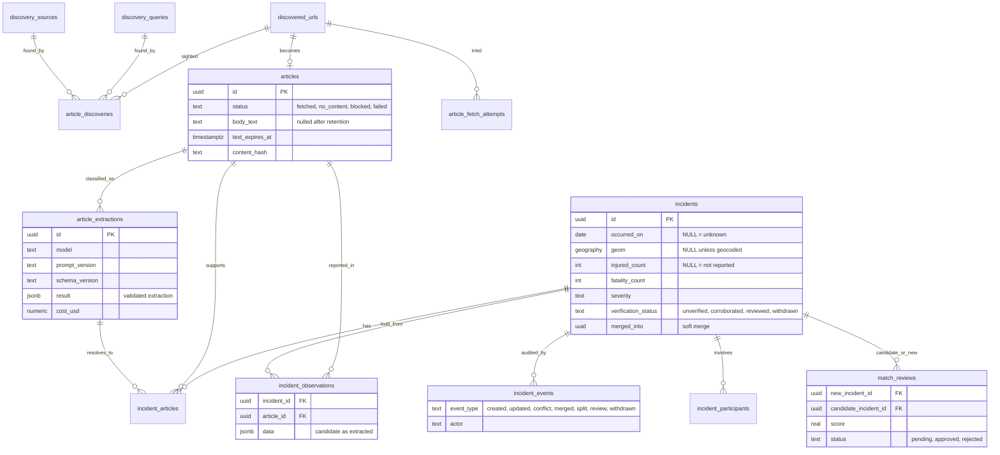

An incident's canonical fields are always recomputed from its observations, so merge, split and reprocessing are
safe operations. Reprocessing can remove all support for an incident, which is then withdrawn (hidden, kept for
audit) rather than deleted.

## API and web

The REST API is defined first in `api/openapi.yaml`. Server code and the web client's types are generated from it,
and requests are validated against it, including the bearer scheme on the few POST routes. Reads are open on the
tailnet; admin routes need a token and are disabled when none is configured.

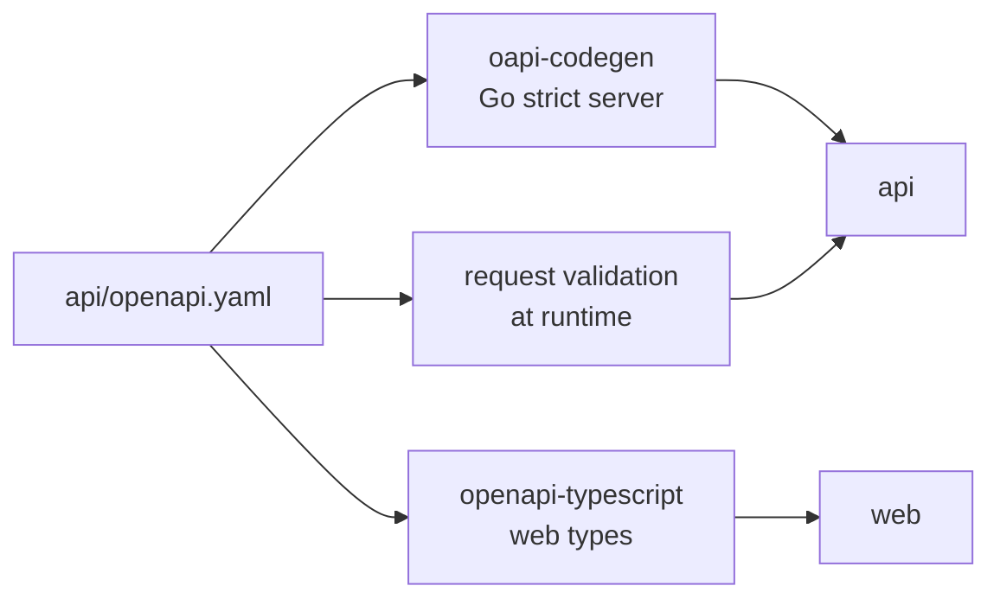

| Page | Data | Temporal feature shown |
|---|---|---|
| Map | clustered incidents with filters kept in the URL | none |
| Trends | summary, time series, breakdowns | none |
| Incident detail | sources, per-article observations, audit trail | link to the incident's workflow |
| Review queue | side-by-side pairs with differences highlighted | decision as a validated Update |
| Operations | source quality, spend, counters | schedule pause, resume, run now |

## Security

- **Crawler:** every resolved IP is validated and the connection is pinned to the checked IP (defeats DNS
  rebinding); redirects are re-validated per hop; robots.txt, size caps and per-domain limits apply; page content is
  never logged.
- **LLM:** article text is data, wrapped in delimiters and escaped. Output is schema-validated and each evidence
  quote must be found in the source text; "verified" is set by our code, never the model.
- **Privacy:** no names or ages are stored for people involved in a collision.
- **Admin:** shared bearer token compared in constant time, kept in `sessionStorage` in the browser. Reviewer identity
  is a typed name recorded in the audit trail, not an authenticated identity.
- **Network:** tailnet-only exposure; in-cluster egress is default-deny with explicit allows (infra repo).

## Not built yet

- Helm chart, Argo applications, Grafana dashboard and runbooks (Phase 5), and the metrics endpoints that
  VictoriaMetrics would scrape.
- The infra changes in the cluster repo: PostGIS image, `collisions` database and Temporal namespace, network
  policies, secrets.
- A geocoder (incidents currently match on street, city and county text), a monthly LLM budget stored in the
  database, a Temporal codec server, a browser-rendering fallback for script-heavy pages, and saga-style
  compensation for merge and split (they are single database transactions today).
